# دليل الاستخدام المصوّر: الامتحان الإلكتروني خطوة بخطوة

هذا الدليل لـ **الأستاذ اللي بيجهّز الامتحان وبيشغّله بنفسه**: من تجهيز الأسئلة مع Claude، لحد ما تطلع العلامات وتسكّر الامتحان. كل خطوة معها صور، واتبعها بالترتيب.

> **ملاحظة عن الصور:** لقطات شاشات المراقبة والتقارير وصفحة الطالب **حقيقية** من النظام (بأسماء وهمية). أما صور النوافذ (المجلد، Excel، النافذة السوداء، المفكرة، جدار الحماية) فهي **رسومات مطابقة لمحتوى الملفات الحقيقي** لتوضيح الفكرة، وشكلها عندك على ويندوز ممكن يختلف شوي. وإطارات البرتقالي المنقّطة هي أماكن لقطات شاشة Claude.

## كيف يشتغل النظام؟ (دقيقة وحدة)

- **جهاز واحد** (لابتوب الأستاذ أو جهاز بالمختبر) بيشغّل «السيرفر» بضغطة على `start.bat`. اسمه **جهاز الأستاذ**.
- كل طالب بيفتح **رابطاً** من جواله أو جهازه (مثل `http://192.168.1.20`)، بيختار اسمه، وبيحل. **لازم كل الأجهزة تكون على نفس الشبكة (نفس الواي فاي).** ما بنحتاج إنترنت.
- الأسئلة والتصحيح والنتائج كلها على جهاز الأستاذ. إجابات الطلاب بتنحفظ عليه أول بأول.
- إنت بتتابع من **شاشة المراقبة** على جهاز الأستاذ نفسه: مين بدأ، مين سلّم، مين انقطع.

<figure class="fig">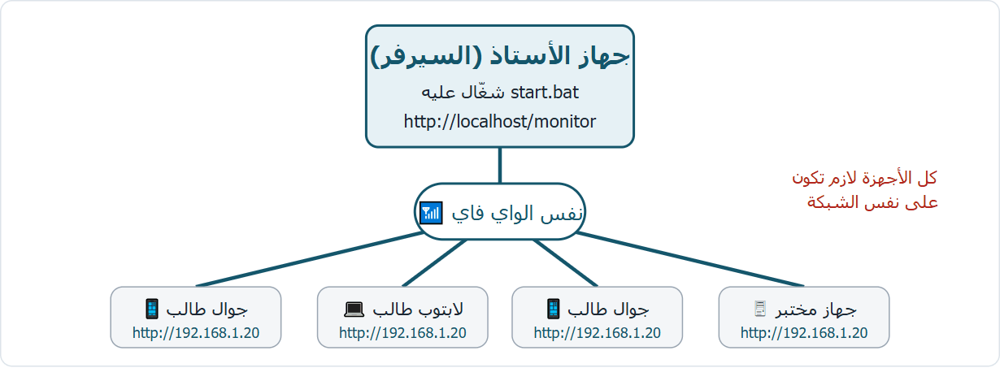<figcaption>الفكرة: جهاز الأستاذ بيشغّل السيرفر، والطلاب بيفتحوا نفس الرابط من نفس الشبكة.</figcaption></figure>

## الخطوات العشر باختصار

| # | الخطوة | شو بتعمل |
|---|---|---|
| 1 | تجهيز الأسئلة | مع Claude: بتعطيه ملف التعليمات والقالب (والكتاب)، وبيطلع لك `exam_data.zip` |
| 2 | وضع الملفات | بترفع الأسئلة (والصور) وأسماء الطلاب من صفحة «الملفات»، أو بتحطهم بمجلد الامتحان |
| 3 | الفحص | دبل كليك على `check_files.bat` |
| 4 | الإعدادات | من صفحة «إعدادات الامتحان»، أو بتفتح `settings.txt`: بتضبط المدة والعلامة وغيرها |
| 5 | التشغيل | دبل كليك على `start.bat` |
| 6 | جدار الحماية | إذا سألك ويندوز: **Allow access** |
| 7 | الرابط | بتعطي الطلاب الرابط |
| 8 | صفحات الأستاذ | المراقبة والتقرير والمفتاح... وشو بتعمل كل وحدة |
| 9 | الطوارئ | شو بتعمل لكل مشكلة |
| 10 | نهاية الامتحان | شو بتسحب وشو بتسكّر |

## قبل ما تبدأ: تجهيز مرة وحدة (أول مرة بس)

1. **فُكّ الزيب كاملاً** على جهاز الأستاذ، وخلّي المجلد خارج OneDrive (مثلاً `C:\exam`). لا تحذف أي ملف منه، **خصوصاً مجلد `python`**: فيه بايثون جاهز، فما بدك تثبّت شي.
2. افتح `settings.txt` وغيّر **كلمة سر المعلم** (السطر `كلمة_سر_المعلم`) بدل `1234`. تفاصيلها بالخطوة 4.
3. جرّب النظام مرة قبل أول امتحان حقيقي (بروفة) كما بالجزء الأخير من الدليل.

<figure class="fig">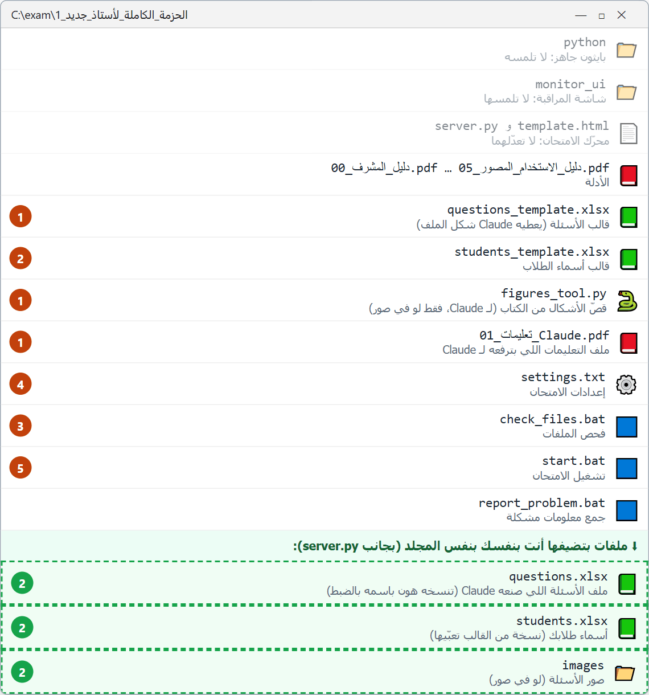<figcaption>محتويات المجلد، والأرقام البرتقالية هي رقم الخطوة اللي بتستعمل فيها الملف. الملفات الباهتة لا تلمسها. وبالأخضر الملفات اللي بتضيفها إنت.</figcaption></figure>

---

## الخطوة 1: تجهيز الأسئلة مع Claude

**الهدف:** تطلع بملف أسئلة جاهز على القالب. هاي الخطوة بتتعمل **مرة وحدة لكل امتحان**، وما بتحتاج أي خبرة بالذكاء الاصطناعي: إنت بتكتب طلبك بالعربي وClaude بيشتغل.

<div class="warn"><b>استعمل Claude فقط.</b> ملف التعليمات مكتوب خصيصاً له، وبرامج الذكاء الاصطناعي الثانية ما انجرّبت: ممكن تطلع بملف مش مطابق للقالب فيرفضه النظام.</div>

### شو بتحتاج

| الملف | ليش | المكان (مثال) |
|---|---|---|
| **`01_تعليمات_Claude.pdf`** | بيفهّم Claude شكل الملف وقواعد الأسئلة (**لازم دايماً**) | مجلد الحزمة |
| **`questions_template.xlsx`** | شكل ملف الأسئلة (**لازم دايماً**) | مجلد الحزمة |
| **كتابك PDF** | عشان الأسئلة تنبني من مادتك (مهم) | أي مكان عندك |
| **`figures_tool.py`** | **بس لو** في أشكال من الكتاب: Claude بيقصّها بنفسه | مجلد الحزمة |

> مجلد الحزمة مثال: `C:\exam\1_الحزمة_الكاملة_لأستاذ_جديد`. عدّله حسب المكان اللي فكيت فيه الزيب.

**ما ترفع لـ Claude أسماء الطلاب أبداً.** هو بيحتاج الأسئلة بس.

### 1.1 افتح Claude وجهّزه

1. افتح المتصفح على **claude.ai** وسجّل دخولك، واضغط على **محادثة جديدة** (New chat).
2. **فعّل «تنفيذ الكود وإنشاء الملفات»** من إعدادات حسابك (Settings، وغالباً تحت قسم Capabilities). بدونه Claude ما بيقدر يطلّع لك ملف Excel ولا يقص الأشكال من الكتاب. إذا ما لقيت الخيار تأكد أن خطة حسابك بتدعمه.

<div class="ph"><b>📷 ضع هنا لقطة شاشة:</b> صفحة الإعدادات في Claude وفيها خيار «تنفيذ الكود وإنشاء الملفات» مفعّلاً.</div>

### 1.2 ارفع الملفات

اضغط زر **الإرفاق** (علامة + أو المشبك 📎 بجانب مربع الكتابة) وارفع الملفات اللي فوق كلها **مرة وحدة**. بتشوف أسماءها فوق مربع الكتابة قبل ما ترسل.

<figure class="fig">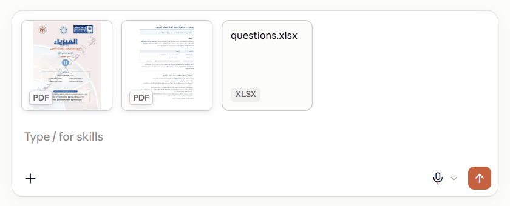<figcaption>شاشة Claude بعد ما رفعت الملفات (الكتاب، ملف التعليمات، قالب الأسئلة). مربع الكتابة لسا فاضي: هون بتكتب البرومبت من الخطوة 1.3، وبعدين تضغط السهم البرتقالي (إرسال).</figcaption></figure>

> بالصورة ما في `figures_tool.py` لأن هالامتحان بدون أشكال. إذا أسئلتك فيها أشكال، ارفعه كمان واحذف أو أبقِ سطر «استعمل figures_tool.py» بالبرومبت.

> إذا رفض Claude الكتاب لأنه كبير: افصل **الفصل أو الوحدة المطلوبة فقط** من الكتاب (بأي برنامج PDF أو من خيار الطباعة ← حفظ كـ PDF) وارفعها بدل الكتاب كله.

### 1.3 اكتب طلبك (البرومبت)

انسخ المثال وغيّر الأرقام والأسماء على امتحانك. **الأرقام الأربعة المهمة:** كم سؤالاً بالبنك، وكم سؤالاً يحل كل طالب، والدرجة الكاملة، والمدة.

**مثال كامل (امتحان فيزياء فيه أشكال من الكتاب):**

<div class="prompt">اقرأ ملف التعليمات المرفق (01_تعليمات_Claude) كاملاً وطبّقه حرفياً.

المطلوب: امتحان اختيار من متعدد في مادة الفيزياء للصف العاشر، من الكتاب المرفق، الوحدة الثانية (من صفحة 38 إلى صفحة 71).

- بنك الأسئلة: 40 سؤالاً (8 صعب، 16 وسط، 16 سهل).
- كل طالب بيحل 10 أسئلة: 2 صعب، 4 وسط، 4 سهل.
- الدرجة الكاملة 20، ومدة الامتحان 30 دقيقة.
- الأسئلة بالعربي.
- بعض الأسئلة لازم يكون فيها أشكال من الكتاب: استعمل figures_tool.py المرفق لقصّها (أنا ما بعرف أقص).
- بدون رمز دخول، وبدون مراجعة أخطاء للطلاب.
- حلّ الأسئلة الحسابية بنفسك قبل التسليم وتأكد أن الإجابات صحيحة.

سلّمني ملف exam_data.zip، وبعده اكتب لي رسالة «طلبات للمشرف».</div>

**مثال أبسط (بدون صور، وبدون كتاب):**

<div class="prompt">اقرأ ملف التعليمات المرفق (01_تعليمات_Claude) كاملاً وطبّقه حرفياً.

المطلوب: امتحان اختيار من متعدد في اللغة الإنجليزية للصف التاسع، الوحدات 1 و2 و3 (القواعد والمفردات).

- بنك الأسئلة: 30 سؤالاً، وكل طالب بيحل كل أسئلة الملف.
- الدرجة الكاملة 30، والمدة 40 دقيقة.
- بدون صور، وبدون رمز دخول، وبدون مراجعة أخطاء.

سلّمني ملف exam_data.zip، وبعده اكتب لي رسالة «طلبات للمشرف».</div>

**نصائح لطلب أفضل:**
- خلّي البنك **ضعف** عدد الأسئلة اللي بيحلها كل طالب على الأقل، عشان تختلف ورقة كل طالب عن زميله (إذا بدك كل الطلاب يحلوا كل الأسئلة، اكتب «كل طالب بيحل كل أسئلة الملف»).
- إذا مش متأكد من رقم، اكتب «اسألني» أو اتركه، وClaude بيسألك.
- لو عندك مستويات (سهل/وسط/صعب) قول له كم من كل مستوى. إذا ما بدك مستويات اكتب «بدون مستويات».

### 1.4 جاوب أسئلة Claude

ممكن Claude يسألك قبل ما يبدأ عن اللي ناقص: المادة والصف والدروس، وعدد الأسئلة من كل مستوى والمدة، وتوزيع العلامات، وهل في أشكال من الكتاب، وهل بدك رمز دخول أو مراجعة أخطاء. جاوبه برسالة وحدة، وكل سؤال برقمه.

<div class="ph"><b>📷 ضع هنا لقطة شاشة:</b> رد Claude وهو بيسأل أسئلة مرقّمة، وإجابتك عليها.</div>

### 1.5 استلم الملف

بعد شوي بيعطيك Claude:
1. **ملف `exam_data.zip`** (بتنزّله بالضغط عليه). فيه `questions.xlsx` ومجلد `images` إذا في صور.
2. **رسالة «طلبات للمشرف»** (نص بالمحادثة فيه المدة وعدد الأسئلة والدرجة الكاملة وغيرها). **انسخها واحفظها**: هي اللي بتعبّي منها `settings.txt` بالخطوة 4.

<div class="ph"><b>📷 ضع هنا لقطة شاشة:</b> رد Claude الأخير: ملف exam_data.zip جاهز للتنزيل ورسالة «طلبات للمشرف».</div>

### 1.6 راجع الأسئلة (ضروري)

<div class="warn"><b>لا تعتمد على الأسئلة بدون مراجعة.</b> Claude بيخطئ أحياناً (خصوصاً بالأسئلة الحسابية والصعبة)، وهو نفسه بينبّهك لهالشي. بعد ما تشغّل النظام (الخطوة 5) افتح صفحة <b>مفتاح الإجابات</b> وراجع كل سؤال مع جوابه الصحيح.</div>

إذا لقيت سؤالاً غلط: ارجع لنفس المحادثة واكتب «**السؤال رقم 12 غلط، الصحيح هو (ج)**» وClaude بيصلّح ويعطيك `exam_data.zip` جديد، وتبدّله بالخطوة 2.

---

## الخطوة 2: وين تحط الملفات

عندك طريقتين: **الأسهل صفحة «الملفات»** (2.0)، أو **تنسخ الملفات يدوياً** لمجلد الحزمة (2.1 إلى 2.3).

### 2.0 الأسهل: ارفعها من صفحة «الملفات»

1. شغّل `start.bat` (الخطوة 5)، وافتح من جهاز السيرفر **`http://localhost/files`** (أو اضغط تبويب **«الملفات»** بأعلى صفحات الأستاذ). بتطلب كلمة سر المعلم.
2. بتشوف **ثلاث خانات**: **1) ملف الأسئلة**، **2) ملف الطلاب**، **3) الصور**. كل وحدة بتعرض اللي موجود حالياً (عدد الأسئلة والمستويات والوحدات، أو عدد الطلاب لكل شعبة) وزر **«تنزيل القالب»**.
3. اختر الملف واضغط **«تحقق وارفع»**. لو الملف سليم بتطلع رسالة خضراء بالملخص، وبيتطبق فوراً بدون ما تعيد تشغيل السيرفر.

<figure class="fig">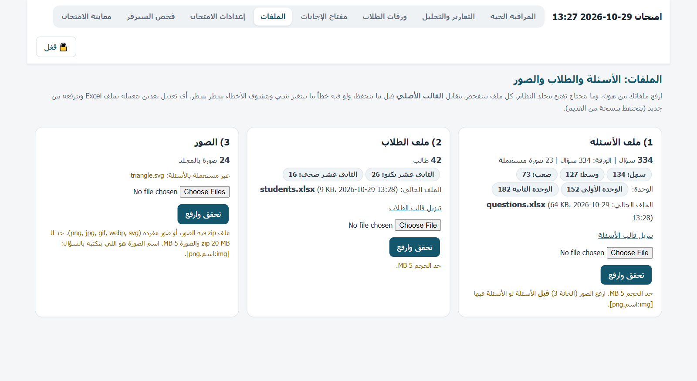<figcaption>صفحة «الملفات»: ثلاث خانات (الأسئلة، الطلاب، الصور)، وكل وحدة بتعرض الموجود حالياً وزر تنزيل القالب وزر «تحقق وارفع».</figcaption></figure>

**الفحص مقابل القالب:** كل ملف بينفحص مقابل **القالب الأصلي** (أعمدته وترتيبها) قبل ما ينحفظ. لو فيه خطأ **ما بيتغير شي**، وبتشوف السبب بالعربي (مع رقم السطر):

<figure class="fig">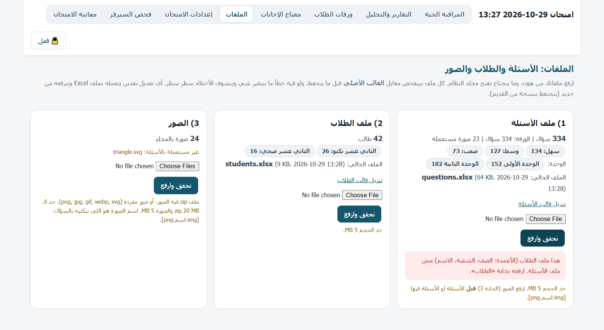<figcaption>مثال: رفعنا ملف الطلاب بخانة الأسئلة، فرفضه وقال لنا نرفعه بخانة «الطلاب».</figcaption></figure>

- بيرفض ملف طلاب بخانة الأسئلة (أو العكس)، وعمود بعنوان غلط أو بمكان غلط، وعناوين مكررة.
- بيرفض إذا بقي **سطر المثال** من القالب («مثال: ما قيمة 2 + 3 × 4؟» أو «اسم الطالب الأول»): احذفه أو بدّله بسؤالك.
- بعدين بيفحص كل سؤال (الجواب أ/ب/ج/د، المستوى، العلامة...) وكل اسم طالب (الصف والشعبة والاسم، وبدون تكرار)، زي ما بيفحصهم `check_files.bat`.
- **الصور:** ارفع الصور **قبل** الأسئلة اللي بتستعملها (`[img:اسم.png]`). بتقدر ترفع ملف **zip** فيه الصور أو صور مفردة (png, jpg, gif, webp, svg). الصورة حتى 5 MB، والـ zip حتى 20 MB.
- نسخة من الملف القديم بتنحفظ لحالها بمجلد نسخ_الملفات قبل ما ينستبدل.
- أي تعديل بتعمله بملف Excel وبترفعه من جديد (ما في تعديل داخل الصفحة).

<div class="ok"><b>القفل:</b> بعد ما <b>يبدأ أول طالب</b> بتنقفل <b>الأسئلة والصور</b> (لأن أوراق الطلاب انسحبت منها). بتقدر بس <b>تضيف طلاب جدد</b>، وما بيسمح بحذف طالب عنده ورقة أو تسليم. لأسئلة جديدة اضغط «بداية امتحان جديد» من المراقبة (الخطوة 10) وبعدها ارفع.</div>

### الطريقة اليدوية (2.1 إلى 2.3)

**كل الملفات بتروح لنفس المكان: مجلد الحزمة، بجانب `server.py`** (مثلاً `C:\exam\1_الحزمة_الكاملة_لأستاذ_جديد\`) (بالصورة اللي فوق: الإطارات الخضراء).

### 2.1 ملف الأسئلة `questions.xlsx`

اختر طريقة وحدة:

- **الأسهل:** انسخ `exam_data.zip` **كما هو (بدون فكّه)** إلى مجلد الحزمة (`C:\exam\1_الحزمة_الكاملة_لأستاذ_جديد\`). النظام بيفكّه لحاله أول ما تشغّله بيطلّع `questions.xlsx` ومجلد `images`. وما بيغيّر قائمة طلابك ولا إعداداتك.
- **أو:** افتح الزيب، وانسخ `questions.xlsx` (ومجلد `images` إن وُجد) إلى مجلد الحزمة. **الاسم لازم يكون `questions.xlsx` بالضبط**، ووافق على الاستبدال إذا سألك.

هيك بيكون شكل الملف جوّاه (بتتحقق منه بعينك فقط، Claude بيعمله):

<figure class="fig">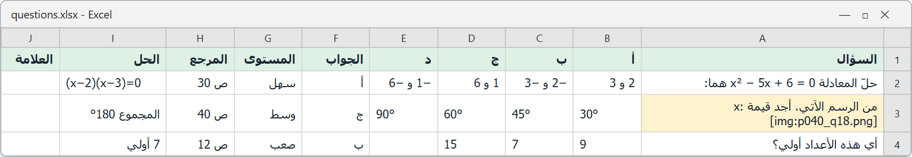<figcaption>ملف الأسئلة: السطر الأول عناوين، وكل سؤال بسطر. الجواب حرف (أ، ب، ج، د). المستوى سهل/وسط/صعب. الخلية الصفراء فيها صورة بالصيغة [img:اسم_الصورة].</figcaption></figure>

### 2.2 أسماء الطلاب `students.xlsx`

1. بمجلد الحزمة انسخ **`students_template.xlsx`** وسمّي النسخة **`students.xlsx`** (لا تحذف القالب). يعني بتصير `C:\exam\1_الحزمة_الكاملة_لأستاذ_جديد\students.xlsx`.
2. افتحها بـ Excel وعبّي الأسماء: الأعمدة **الصف، الشعبة، الاسم**، والعمود الرابع «الرمز» **اختياري** (اتركه فاضي).
3. احفظ وسكّر Excel.

<figure class="fig narrow">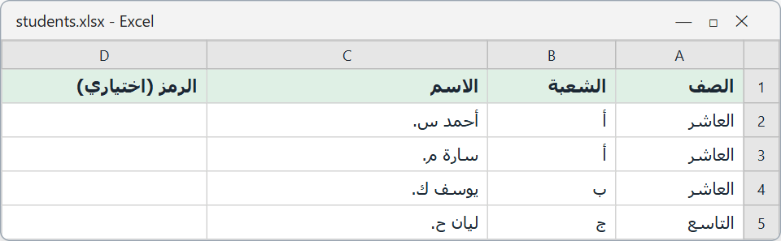<figcaption>ملف الطلاب: صف وشعبة واسم لكل طالب.</figcaption></figure>

- حط **كل طلاب المختبر** من كل الصفوف والشعب: القائمة نفسها بتخدم كل الامتحانات، وبتحدّثها فقط لما يتغير الطلاب.
- **لا تكرر اسماً** داخل نفس الشعبة (اكتب «أحمد س.» و«أحمد ك.» بدل أحمد مرتين).
- أسماء الطلاب بتبقى عندك على الجهاز، وما بتنرفع لأي مكان.

### 2.3 الصور (فقط إذا في صور بالأسئلة)

- الصور لازم تكون **داخل مجلد اسمه `images`** بجانب `server.py`. إذا نسخت `exam_data.zip` كما هو بتنحط لحالها.
- اسم الصورة بالمجلد لازم يكون **نفس الاسم** المكتوب بالسؤال (`[img:p040_q18.png]` ← الملف `p040_q18.png`).
- مجلد `images` ممكن يضل فيه صور امتحانات قديمة، ما بتضر.
- إذا نقصت صورة، `check_files.bat` (الخطوة 3) بيقول لك أي صورة ناقصة.

<div class="ok"><b>تذكير:</b> إذا هذا مش أول امتحان على هالجهاز، وبعدك ما ضغطت «بداية امتحان جديد» من الامتحان اللي قبله، اعملها <b>قبل</b> ما تحط الملفات الجديدة (انظر الخطوة 10).</div>

---

## الخطوة 3: افحص الملفات بـ `check_files.bat`

**الهدف:** تتأكد قبل التشغيل إن كل شي موجود وسليم.

1. دبل كليك على **`check_files.bat`** (`C:\exam\1_الحزمة_الكاملة_لأستاذ_جديد\check_files.bat`).
2. بتظهر نافذة سوداء، وبتفتح بعدها المفكرة بملف `check_report.txt` فيه التقرير **بالعربي**.

<figure class="fig">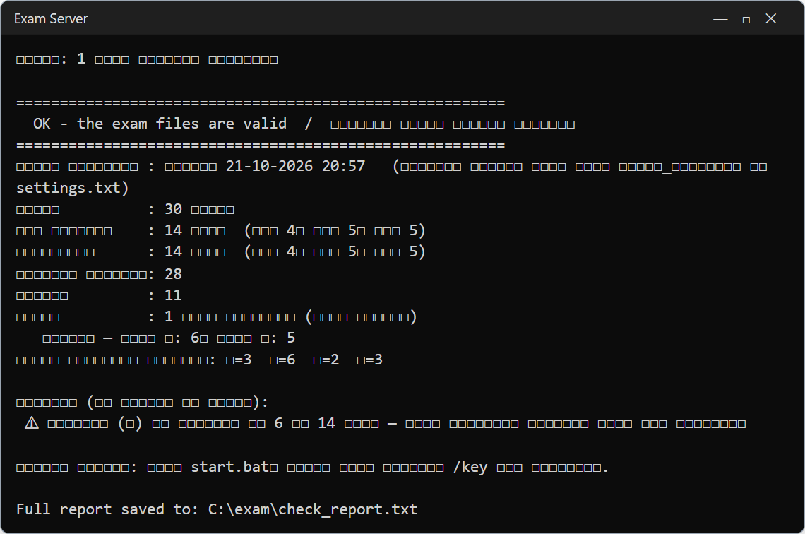<figcaption>النافذة السوداء ما بتعرض الحروف العربية (بتطلع مربعات □)، وهذا طبيعي. التقرير العربي الكامل بيفتح بالمفكرة.</figcaption></figure>

**شو تتأكد منه:**

| بالتقرير | لازم يطابق |
|---|---|
| **OK - the exam files are valid** (سطر «الملفات سليمة وقابلة للتشغيل») | ظاهر بدل رسالة خطأ |
| **المدة** | اللي طلبته من Claude (مثلاً 30 دقيقة) |
| **بنك الأسئلة / بالامتحان** | عدد البنك وعدد اللي بيحله كل طالب (مثلاً 40 و10) |
| **العلامة الكاملة** | الدرجة الكاملة المطلوبة |
| **الطلاب** | عدد طلابك |
| **الصور** | «كلها موجودة» |

- **⚠ التنبيهات** مش أخطاء، لكن اقرأها (مثلاً «الإجابة ب هي الصحيحة بعدد كبير: وزّع الإجابات»). تقدر تطلب من Claude يوزّعها.
- **إذا ظهر خطأ** («في مشكلة بالملفات») بيفتح `exam_error.txt` فيه رقم السطر والسبب. أرسله لـ Claude (بنفس المحادثة) ليصلّح الملف.

| الرسالة | الحل |
|---|---|
| `Missing file: ...` | ملف ناقص: تأكد من أسماء `questions.xlsx` و`students.xlsx` بالضبط وأنهم بجانب `server.py` |
| «الصورة ... غير موجودة بمجلد images» | حط الصورة بمجلد `images` بنفس الاسم |
| عدد الأسئلة المطلوب أكبر من البنك | قلّل العدد بـ `settings.txt` أو اطلب من Claude أسئلة أكثر |
| الملف مفتوح بـ Excel | سكّر Excel وأعد الفحص |

---

## الخطوة 4: ضبط الإعدادات بملف `settings.txt`

**الهدف:** تكتب مدة الامتحان وعدد الأسئلة والعلامة وغيرها، **حسب «طلبات للمشرف»** اللي أعطاك Claude. عندك طريقتين: **الأسهل صفحة «إعدادات الامتحان»** (4.0)، أو **تعدّل `settings.txt` بالمفكرة** (الطريقة اليدوية).

### 4.0 الأسهل: من صفحة «إعدادات الامتحان»

1. شغّل `start.bat`، وافتح من جهاز السيرفر **`http://localhost/settings`** (أو تبويب **«إعدادات الامتحان»** بأعلى صفحات الأستاذ). بتطلب كلمة سر المعلم.
2. **الإعدادات العامة:** كل إعداد بحقل جاهز وتحته شرحه: العنوان، المدة، العلامة النهائية، خلط الأسئلة والخيارات، إظهار العلامة، مراجعة الأخطاء، رمز الدخول، كلمة سر المعلم، وتعويض وقت توقف السيرفر. غيّر اللي بدك، والحقل الفاضي = الافتراضي.

<figure class="fig">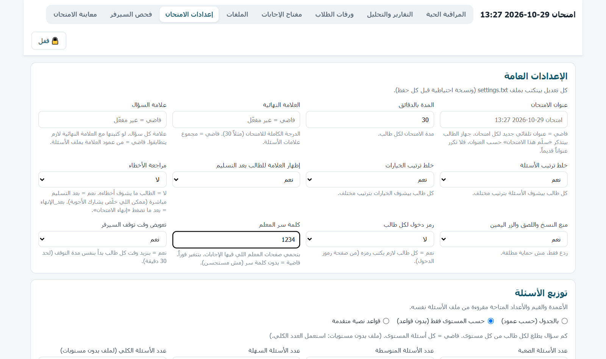<figcaption>صفحة «إعدادات الامتحان»: الإعدادات العامة بحقول جاهزة مع شرح كل واحد، وتحتها «توزيع الأسئلة».</figcaption></figure>

3. **توزيع الأسئلة:** كم سؤال يطلع لكل طالب. ثلاث طرق: **«حسب المستوى فقط»** (صعب/وسط/سهل)، أو **«بالجدول (حسب عمود)»**: بتختار عموداً من ملف الأسئلة (مثل «الوحدة») وبتكتب العدد لكل وحدة ومستوى. الأعمدة والقيم والأعداد المتاحة **مقروءة من ملف الأسئلة نفسه** (3 وحدات = 3 بطاقات)، والخانة بتحمر لو طلبت أكثر من المتاح. أو **«قواعد نصية متقدمة»**: أسطر مثل `سحب = الوحدة:الوحدة الأولى | المستوى:سهل | العدد:10`.

<figure class="fig">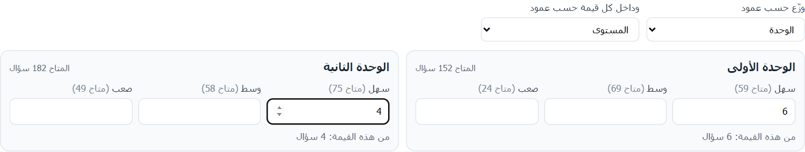<figcaption>«بالجدول»: بطاقة لكل وحدة، وتحت كل مستوى خانة للعدد مع المتاح من الملف (هون 6 أسئلة سهلة من الوحدة الأولى و4 من الثانية).</figcaption></figure>

4. اضغط **«حفظ الإعدادات»**: بيكتب نفس `settings.txt` (التعليقات بتضل) وبيحفظ **نسخة قبل كل مرة** بمجلد `نسخ_الإعدادات` (آخر 50)، وبيطبّق التغيير **فوراً بدون إعادة تشغيل**. لو في خطأ ما بيتغير شي وبتشوف السبب. و**«رجوع للافتراضي»** بيشيل كل الإعدادات ما عدا كلمة السر.

<div class="ok"><b>القفل:</b> بعد ما <b>يبدأ أول طالب</b> بتنقفل الإعدادات اللي بتأثر على الأوراق (المدة، عدد الأسئلة، التوزيع...). بتضل مفتوحة: <b>كلمة السر، وإظهار العلامة، ومراجعة الأخطاء</b>. لتعديل الباقي اضغط «بداية امتحان جديد» أولاً (الخطوة 10).</div>

### الطريقة اليدوية: ملف `settings.txt`

1. اضغط **يمين** على `settings.txt` (`C:\exam\1_الحزمة_الكاملة_لأستاذ_جديد\settings.txt`) ← **فتح باستخدام** ← **المفكرة** (Notepad).
2. غيّر **بعد علامة `=` فقط**، واحفظ (`Ctrl+S`).
3. **السطر الفاضي بعد `=` يعني القيمة الافتراضية.** والسطور اللي بتبدأ بـ `#` شروحات، لا تلمسها.

<figure class="fig">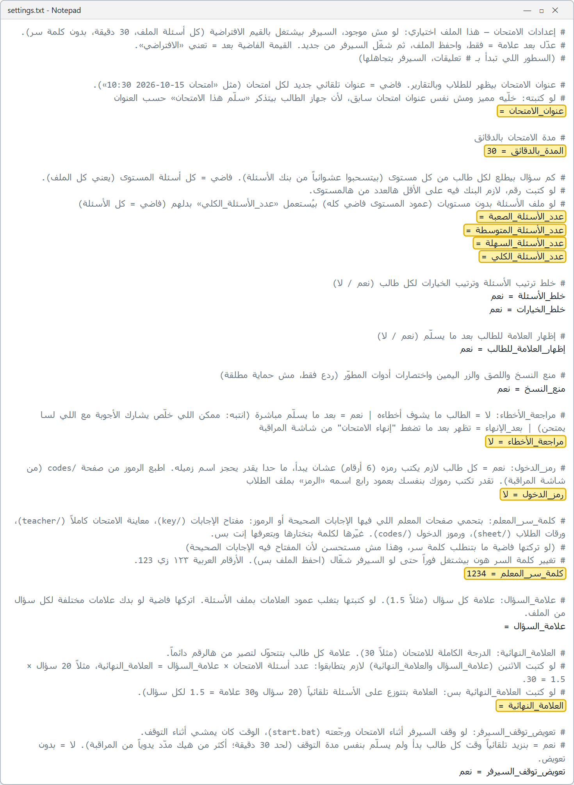<figcaption>ملف settings.txt: الأسطر المظلّلة هي اللي بتغيّرها غالباً.</figcaption></figure>

### كل الإعدادات

| السطر | شو بيعمل | القيم | الافتراضي |
|---|---|---|---|
| `عنوان_الامتحان` | العنوان اللي بيظهر للطلاب وبالتقارير | أي نص، **ومش نفس عنوان امتحان سابق** | فاضي = عنوان تلقائي (مثل «امتحان 21-10-2026 10:30») وهو الأسلم |
| `المدة_بالدقائق` | مدة الامتحان لكل طالب | رقم | 30 |
| `عدد_الأسئلة_الصعبة` | كم سؤالاً **صعباً** بيطلع لكل طالب (بيتسحبوا عشوائياً من البنك) | رقم، ولازم البنك فيه على الأقل هالعدد | فاضي = كل الأسئلة الصعبة |
| `عدد_الأسئلة_المتوسطة` | كم سؤالاً **وسطاً** لكل طالب | رقم | فاضي = كل أسئلة الوسط |
| `عدد_الأسئلة_السهلة` | كم سؤالاً **سهلاً** لكل طالب | رقم | فاضي = كل الأسئلة السهلة |
| `عدد_الأسئلة_الكلي` | بدل الثلاثة السابقة **إذا ملفك بدون مستويات** | رقم | فاضي = كل الأسئلة |
| `خلط_الأسئلة` | ترتيب الأسئلة مختلف لكل طالب | نعم / لا | نعم |
| `خلط_الخيارات` | ترتيب الخيارات مختلف لكل طالب | نعم / لا | نعم |
| `إظهار_العلامة_للطالب` | يشوف علامته بعد التسليم | نعم / لا | نعم |
| `منع_النسخ` | يمنع النسخ واللصق والزر اليمين (ردع فقط، مش حماية مطلقة) | نعم / لا | نعم |
| `مراجعة_الأخطاء` | الطالب يشوف أخطاءه: **لا** = أبداً، **بعد_الإنهاء** = بعد ما تضغط «إنهاء الامتحان» (الأفضل)، **نعم** = فور التسليم (ممكن اللي خلّص يشارك الإجابات) | لا / نعم / بعد_الإنهاء | لا |
| `رمز_الدخول` | كل طالب لازم يكتب رمزه (6 أرقام) ليبدأ، فما حدا يستعمل اسم زميله. بتطبع الرموز من صفحة `/codes` | نعم / لا | لا |
| `كلمة_سر_المعلم` | بتحمي صفحات الإجابات والرموز (`/key` و`/teacher` و`/sheet` و`/codes`) | أي كلمة | `1234` (**غيّرها!**) |
| `علامة_السؤال` | علامة كل سؤال (مثلاً 1.5) وبتغلب عمود العلامات بملف الأسئلة | رقم | فاضي |
| `العلامة_النهائية` | الدرجة الكاملة للامتحان (علامة كل طالب بتتحوّل لتصير منها) | رقم | فاضي |
| `تعويض_توقف_السيرفر` | لو وقف السيرفر أثناء الامتحان، بيزيد وقت الطلاب بنفس مدة التوقف (لحد 30 دقيقة) | نعم / لا | نعم |

### مثال: «طلبات للمشرف» ← الإعدادات

إذا كتب Claude: *المدة 30 دقيقة، 2 صعب و4 وسط و4 سهل، الدرجة الكاملة 20، بدون رمز دخول ولا مراجعة*، فاكتب:

```
المدة_بالدقائق = 30
عدد_الأسئلة_الصعبة = 2
عدد_الأسئلة_المتوسطة = 4
عدد_الأسئلة_السهلة = 4
العلامة_النهائية = 20
رمز_الدخول = لا
مراجعة_الأخطاء = لا
كلمة_سر_المعلم = (كلمة بتختارها إنت)
```

<div class="warn"><b>غيّر كلمة السر.</b> هي اللي بتحمي مفتاح الإجابات الصحيحة. تغييرها بيشتغل فوراً بعد الحفظ، أما باقي الإعدادات فبتحتاج تشغّل <code>start.bat</code> من جديد.</div>

> **ملاحظة:** إذا كتبت `علامة_السؤال` و`العلامة_النهائية` معاً لازم يتطابقوا: عدد الأسئلة × علامة السؤال = العلامة النهائية (مثلاً 10 × 2 = 20). الأسهل تكتب `العلامة_النهائية` وبس.

---

## الخطوة 5: تشغيل الامتحان بـ `start.bat`

1. دبل كليك على **`start.bat`** (`C:\exam\1_الحزمة_الكاملة_لأستاذ_جديد\start.bat`).
2. بتظهر **نافذة سوداء**، وبتفتح المفكرة لحالها بملف **`exam_info.txt`** (فيه الرابط وصفحات الأستاذ بالعربي).

<figure class="fig">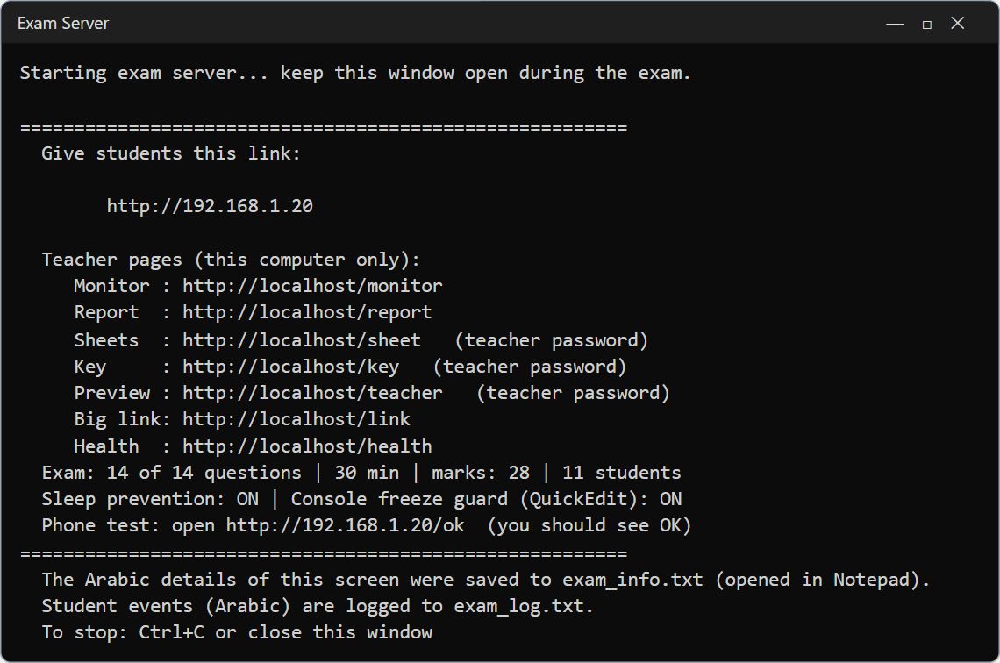<figcaption>النافذة السوداء بعد التشغيل. الرابط تحت «Give students this link».</figcaption></figure>

**قواعد النافذة السوداء:**
- **خلّيها مفتوحة طول الامتحان** (صغّرها بس). إذا سكّرتها الامتحان بيوقف.
- **لا تضغط بالماوس جواها.**
- النظام **بيمنع الجهاز من النوم** لحاله. لكن لا تسكّر غطاء اللابتوب.
- لو سكّرتها بالغلط: شغّل `start.bat` من جديد من نفس المجلد، بيرجع كل شي (الأوراق والإجابات) والوقت بيتعوّض تلقائياً.
- **لا تشغّل `start.bat` مرتين من نفس المجلد.** النسخة الثانية بترفض وبتكتب «ALREADY RUNNING».

### وقت الامتحان وشو بيصير لما يخلص

- وقت **كل طالب** بيبدأ من لحظة ضغطه **«ابدأ الامتحان»** (مش من لحظة ما شغّلت إنت)، وبيمشي بساعة **السيرفر**.
- **الطالب ما بيقدر يتجاوز المدة:** لما يخلص وقته بتتسلّم صفحته **تلقائياً** بإجاباته المحفوظة وبتظهر شاشة «تم تسليم الامتحان». وإذا سكّر الصفحة ورجع بعد انتهاء وقته بتتسلّم فوراً.
- الوقت بيمشي **حتى لو سكّر الصفحة أو انقطع النت**.
- لو بدك تعطي وقتاً إضافياً: **من المراقبة وقبل ما ينتهي وقت الطالب** (الخطوة 8).

<figure class="fig">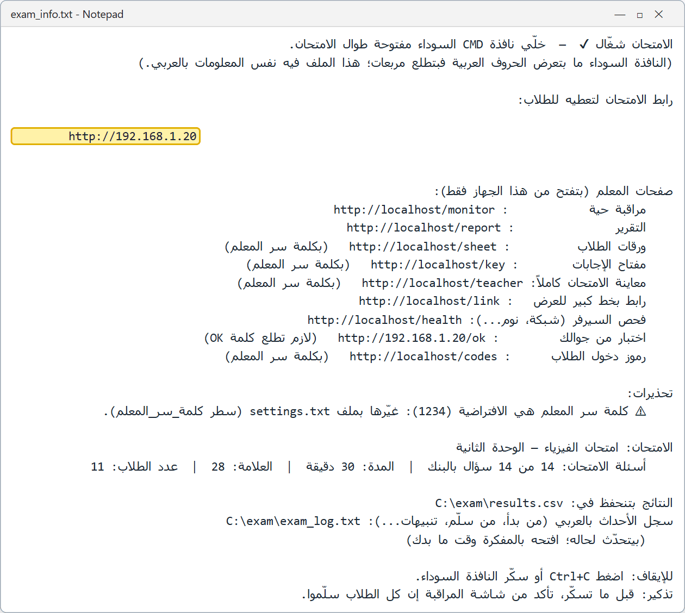<figcaption>ملف exam_info.txt بيفتح لحاله بالمفكرة: الرابط (المظلّل) وصفحات الأستاذ. بتفتحه بأي وقت من مجلد الامتحان.</figcaption></figure>

---

## الخطوة 6: نافذة «Windows Security Alert» (Allow access)

أول مرة تشغّل فيها `start.bat` على الجهاز، ممكن يطلع لك ويندوز بنافذة تسأل إذا بدك تسمح لـ **Python** بالاتصال بالشبكة.

- اضغط **Allow access** (والخيار **Private networks** لازم يكون معلّم ✔).
- **لا تضغط Cancel.** لو ضغطته الطلاب ما رح يقدروا يفتحوا الرابط من أجهزتهم.

<figure class="fig narrow">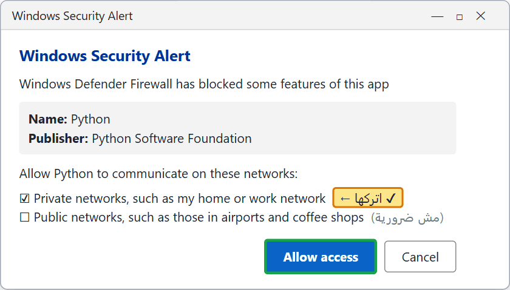<figcaption>شكل تقريبي للنافذة (رسم توضيحي): اضغط Allow access.</figcaption></figure>

إذا ضغطت Cancel بالغلط: افتح **Windows Defender Firewall ← Allow an app through firewall** وفعّل Python للشبكات الخاصة (Private)، أو شغّل `start.bat` من جديد.

<div class="ph"><b>📷 ضع هنا لقطة شاشة حقيقية:</b> نافذة Windows Security Alert على جهازك مع الإشارة على زر Allow access (اطلعها بتشغيل start.bat أول مرة).</div>

---

## الخطوة 7: وين تلاقي الرابط وكيف توزّعه على الطلاب

**الرابط هو اللي بيفتحه الطلاب من أجهزتهم.** شكله `http://192.168.1.20` (الأرقام بتختلف من مكان لمكان).

**بتلاقيه بـ 4 أماكن:**
1. **المفكرة `exam_info.txt`** اللي بتفتح بعد التشغيل (المظلّل بالصورة فوق).
2. **النافذة السوداء** تحت `Give students this link`.
3. **شاشة المراقبة** (`http://localhost/monitor`): بطاقة «رابط الامتحان للطلاب» فيها زر **نسخ الرابط** وزر **عرض بخط كبير**.
4. **صفحة الرابط الكبير** `http://localhost/link`: بتعرض الرابط بخط ضخم، افتحها على شاشة العرض أو البروجكتر.

<figure class="fig">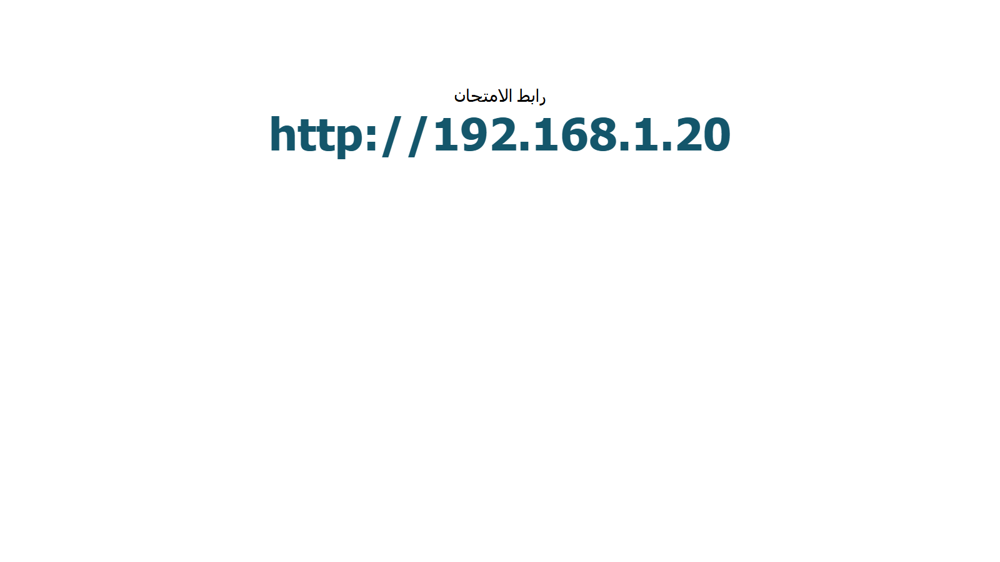<figcaption>صفحة /link: الرابط بخط كبير للعرض على الشاشة أو البروجكتر.</figcaption></figure>

**كيف توزّعه:** اكتبه على السبورة، أو اعرضه بالبروجكتر، أو ابعته بمجموعة الصف. وإذا في أكثر من رابط بالنافذة، استعمل **الأساسي** (الأول).

**قبل ما يبدأ الطلاب، جرّب بنفسك:** من جوالك (على نفس الواي فاي) افتح `الرابط/ok` (مثلاً `http://192.168.1.20/ok`). لازم تشوف كلمة **OK**. إذا ما اشتغلت: الجوال مش على نفس الشبكة، أو جدار الحماية (الخطوة 6)، أو افتح `http://localhost/health` (الخطوة 8).

### شو بيشوف الطالب؟

1. بيفتح الرابط، وبيختار **الصف ثم الشعبة ثم اسمه** (وبيكتب **رمزه** إذا فعّلت رمز الدخول)، وبيضغط «ابدأ الامتحان».
2. بيحل سؤالاً بكل صفحة، وبيتنقل بزرّي «السؤال التالي/السابق» أو من **خريطة الأسئلة**.
3. بآخر سؤال بيظهر زر **تسليم الامتحان**، وبعد التأكيد بتظهر علامته (إذا سمحت).

<figure class="fig third">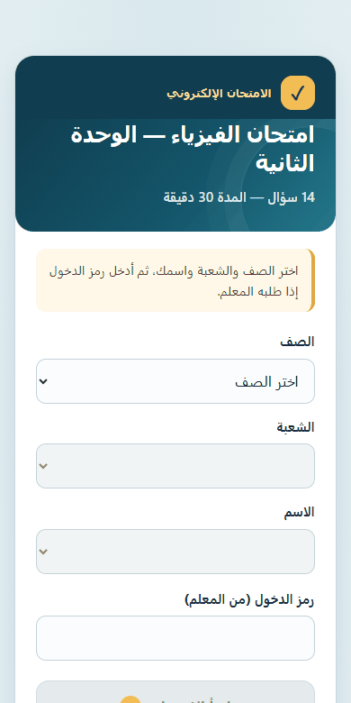<figcaption>(1) اختيار الصف والشعبة والاسم</figcaption></figure>

<figure class="fig third">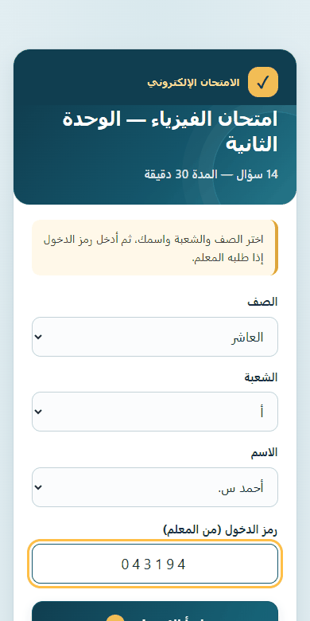<figcaption>(2) كتابة الرمز (إذا مفعّل رمز الدخول)</figcaption></figure>

<figure class="fig third">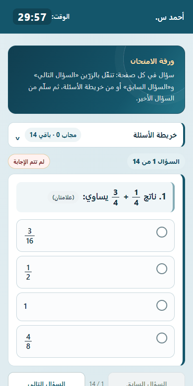<figcaption>(3) صفحة الأسئلة، والوقت أعلى اليسار</figcaption></figure>

<figure class="fig third">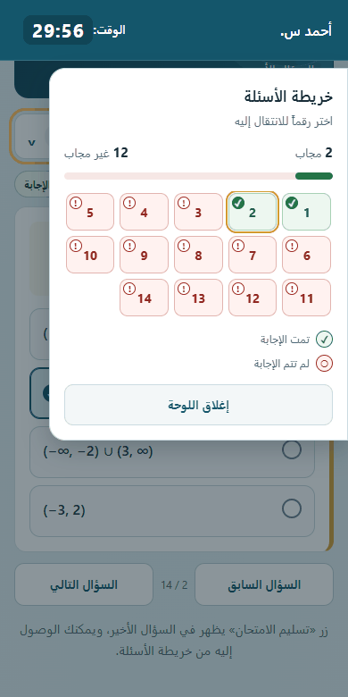<figcaption>(4) خريطة الأسئلة: أي سؤال لسا ما انجاب</figcaption></figure>

<figure class="fig third">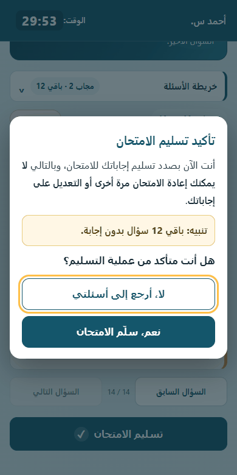<figcaption>(5) تأكيد التسليم، وبيحذّره من الأسئلة اللي ما جاوب عنها</figcaption></figure>

<figure class="fig third">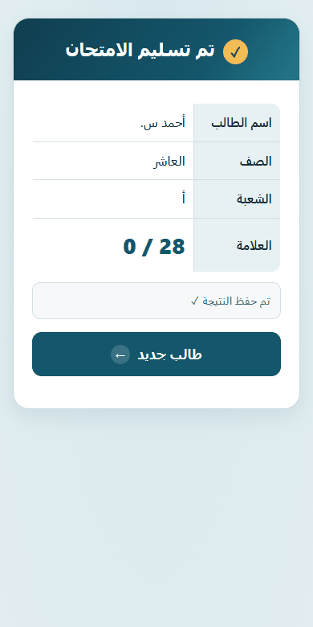<figcaption>(6) شاشة «تم التسليم» وعلامته. زر «طالب جديد» لو طالبين على نفس الجهاز</figcaption></figure>

---

## الخطوة 8: صفحات الأستاذ (الـ localhost)

**معنى `localhost`:** يعني «**هذا الجهاز نفسه**». عناوين زي `http://localhost/monitor` بتفتحها **من جهاز الأستاذ فقط** (بمتصفح Chrome أو Edge)، والطلاب **ما بيقدروا** يفتحوها حتى لو عرفوها. وفي أعلى كل صفحة **شريط تنقل** تنتقل منه بين الصفحات بدون ما تكتب العناوين.

<figure class="fig">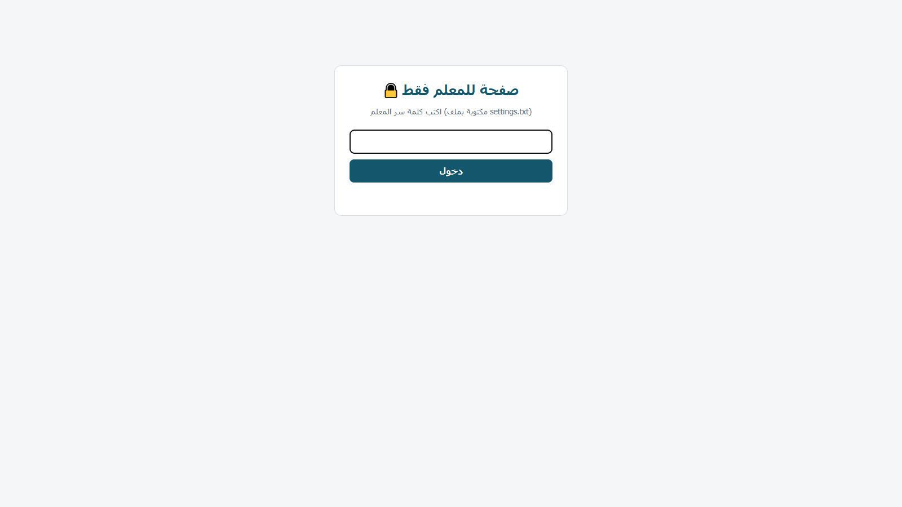<figcaption>الصفحات اللي فيها إجابات صحيحة أو رموز بتطلب كلمة سر المعلم (اللي كتبتها بـ settings.txt) أول مرة.</figcaption></figure>

| الصفحة | شو بتعمل | متى |
|---|---|---|
| `http://localhost/monitor` | **المراقبة الحية**: مين بدأ، مين سلّم، مين انقطع، وكل أوامرك (تمديد، رسالة، إنهاء...) | **طول الامتحان** |
| `http://localhost/report` | **التقرير**: أرقام ورسوم (المتوسط، نسبة النجاح، توزيع العلامات) وتحليل الأسئلة. وفيه زر تنزيل Excel وزر طباعة | بعد الامتحان (وأثناءه) |
| `http://localhost/report.xlsx` | ملف **Excel** بعلامات كل شعبة وتحليل الأسئلة (للتنزيل) | بعد الامتحان |
| `http://localhost/sheet` | **ورقات الطلاب**: ورقة لكل طالب (أسئلته وإجاباته وعلامته) للعرض أو الطباعة | بعد الامتحان |
| `http://localhost/key` | **مفتاح الإجابات**: كل الأسئلة مع الجواب الصحيح (**كلمة سر**) | **قبل الامتحان** لمراجعة الأسئلة |
| `http://localhost/teacher` | **معاينة الامتحان كاملاً**: بتحلّه إنت كأنك طالب، والنتيجة ما بتنحفظ (**كلمة سر**) | قبل الامتحان |
| `http://localhost/codes` | **رموز دخول الطلاب** للطباعة (بس لو فعّلت `رمز_الدخول`) (**كلمة سر**) | قبل الامتحان |
| `http://localhost/settings` | **إعدادات الامتحان**: كل إعدادات `settings.txt` بحقول جاهزة، وتوزيع الأسئلة بالجدول، وتطبيق فوري بنسخة احتياطية (**كلمة سر**). بتنقفل إعدادات الأوراق بعد بدء الامتحان | قبل الامتحان |
| `http://localhost/files` | **الملفات**: رفع الأسئلة والطلاب والصور من النظام مع فحصها مقابل القالب (**كلمة سر**). بتنقفل الأسئلة والصور بعد بدء الامتحان | قبل الامتحان |
| `http://localhost/health` | **فحص السيرفر**: هل الشبكة شغّالة، الرابط، كم جهاز وصل، الوقت، مساحة القرص | قبل الامتحان وعند أي مشكلة |
| `http://localhost/link` | **الرابط بخط كبير** للعرض على الطلاب | عند توزيع الرابط |
| `الرابط/ok` (من الجوال) | اختبار: لازم تظهر كلمة **OK** | قبل الامتحان |
| `http://localhost/monitor-old` | شاشة المراقبة القديمة، احتياط إذا حصل خلل بالجديدة | نادراً |

> زر **🔒 قفل** بأعلى الصفحات بيسجّل خروجك، اضغطه عند الانتهاء إذا الجهاز مشترك.

### شاشة المراقبة بالتفصيل

<figure class="fig">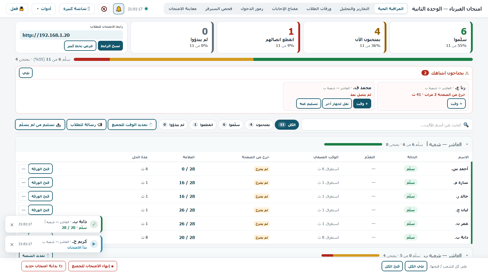<figcaption>شاشة المراقبة أثناء الامتحان.</figcaption></figure>

**من أعلى لأسفل:**

1. **شريط التنقل:** تبويبات الصفحات، وبالزاوية: 🔔 الإشعارات، 🔊 الصوت، 🖥 شاشة كبيرة، أدوات ▾، 🔒 قفل.

<figure class="fig">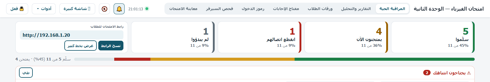<figcaption>أعلى شاشة المراقبة: شريط التنقل والعدّادات الأربعة وبطاقة الرابط.</figcaption></figure>

<figure class="fig half">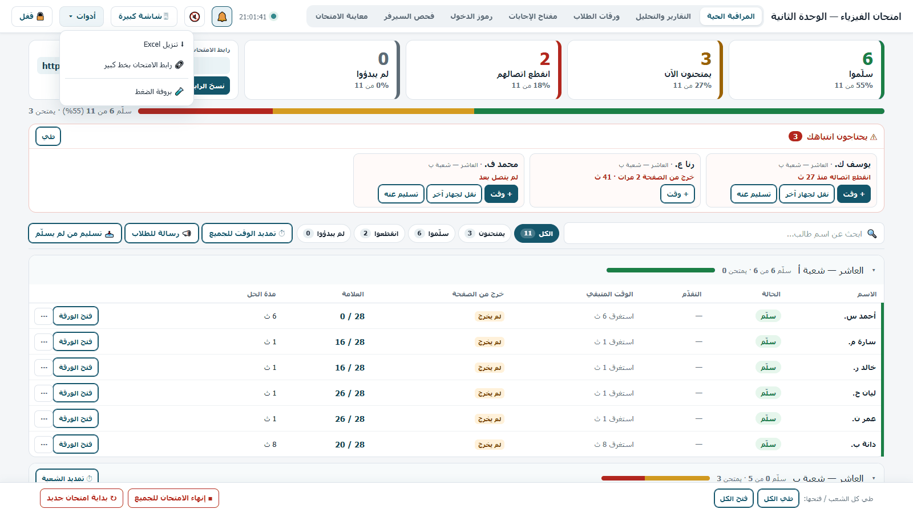<figcaption>قائمة «أدوات ▾»: تنزيل Excel، الرابط بخط كبير، بروفة الضغط.</figcaption></figure>

<figure class="fig half">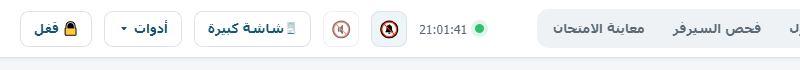<figcaption>زر 🔔 (إيقاف الإشعارات) وزر 🔊/🔇 (الصوت).</figcaption></figure>

*(تكملة الشرح:)*

2. **أربع بطاقات عدّادات:** **سلّموا** (أخضر) | **يمتحنون الآن** (أصفر) | **انقطع اتصالهم** (أحمر) | **لم يبدؤوا** (رمادي). اضغط أي بطاقة وبيتفلتر الجدول عليها، واضغطها مرة ثانية ليرجع الكل. وبجانبها **رابط الامتحان** مع زر نسخ.
3. **شريط التقدّم:** كم نسبة اللي سلّموا.
4. **«يحتاجون انتباهك»:** الطلاب اللي لازم تتدخل معهم، وجنب كل واحد الأزرار المناسبة (انظر الصورة التالية).
5. **البحث والفلاتر** وأزرار الأوامر الجماعية: **⏱ تمديد الوقت للجميع**، **📣 رسالة للطلاب**، **📥 تسليم من لم يسلّم**.
6. **جدول كل شعبة:** الاسم والحالة والتقدّم والوقت المتبقي ومرات الخروج من الصفحة والعلامة ومدة الحل، وبآخر كل صف أزرار وقائمة **⋯**.
7. **شريط أسفل الصفحة:** **■ إنهاء الامتحان للجميع** و**↻ بداية امتحان جديد** (حمر، فيهم تأكيد).

<figure class="fig">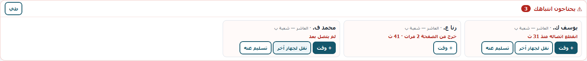<figcaption>لوحة «يحتاجون انتباهك»: انقطع الاتصال، أو خرج من الصفحة أكثر من مرتين أو 30 ثانية، أو سلّم متأخراً، أو قارب وقته على الانتهاء وما جاوب إلا القليل، أو إيقاف مؤقت طوّل.</figcaption></figure>

<figure class="fig">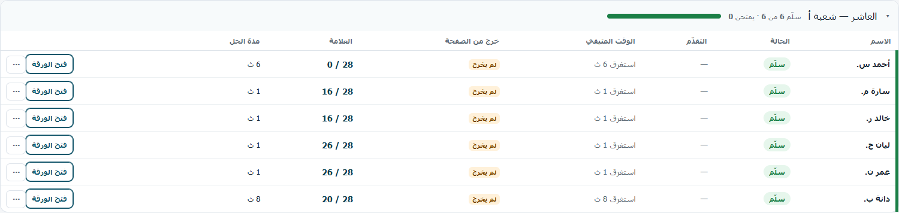<figcaption>جدول شعبة: ألوان الحالة، والوقت المتبقي، وإيقاف مؤقت (⏸ موقوف)، وانقطاع الاتصال.</figcaption></figure>

### الإشعارات الحية

تظهر **بطاقات صغيرة بزاوية الشاشة** لما يصير حدث: **بدأ الامتحان** ▶، **سلّم** ✓ (مع علامته)، **انقطع اتصاله** ⚠، **عاد اتصاله** ↺، **خرج من الصفحة** ↗، **أُعيد فتحه** ↩. التحذيرات بتبقى أطول من غيرها (12 ثانية)، والأحداث الكتيرة (أكثر من 3 من نوع واحد) بتتجمّع ببطاقة وحدة.

- زر **🔔** بيوقف الإشعارات أو بيشغّلها.
- زر **🔊** بيشغّل **نغمة قصيرة** مع السلّم والانقطاع (**مطفّأ افتراضياً**، وبتسمع نغمة تجريبية لما تفعّله). المتصفح ممكن يطلب منك ضغطة أولى بالصفحة قبل ما يسمح بالصوت.
- اختيارك بيتحفظ على هالمتصفح.

<figure class="fig">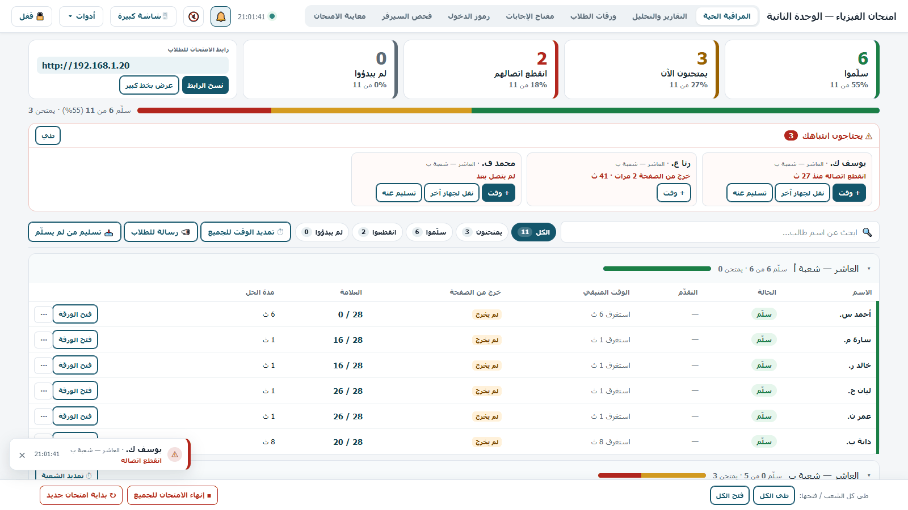<figcaption>إشعار «انقطع اتصاله» (أحمر) أسفل الصفحة.</figcaption></figure>

### القائمة ⋯ بجانب كل طالب

<figure class="fig">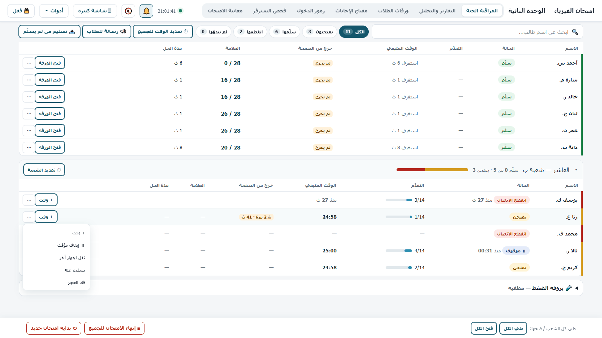<figcaption>قائمة طالب يمتحن: + وقت، إيقاف مؤقت، نقل لجهاز آخر، تسليم عنه، فك الحجز.</figcaption></figure>

| الأمر | شو بيعمل | متى |
|---|---|---|
| **+ وقت** | بيزيد وقت هالطالب (1 إلى 120 دقيقة) | **قبل ما ينتهي وقته** |
| **⏸ إيقاف مؤقت** / **▶ متابعة** | بيغطّي شاشته ويجمّد وقته، وإجاباته محفوظة | طالب بدّه يطلع (حمّام مثلاً) |
| **نقل لجهاز آخر** | بيكمل من جهاز ثاني بنفس أسئلته وإجاباته ووقته | تعطّل جهازه |
| **تسليم عنه** | بيصحّح إجاباته المحفوظة وبيسجّلها | ما رجع وانتهى الوقت |
| **↩ إعادة فتح للطالب** (لمن «سلّم») | بتنلغي علامته وبيرجع لأسئلته بإجاباته ووقته الباقي | سلّم بالغلط |
| **فك الحجز** | بيبدأ الطالب **من جديد** وبتضيع إجاباته | **للضرورة فقط** |

<figure class="fig">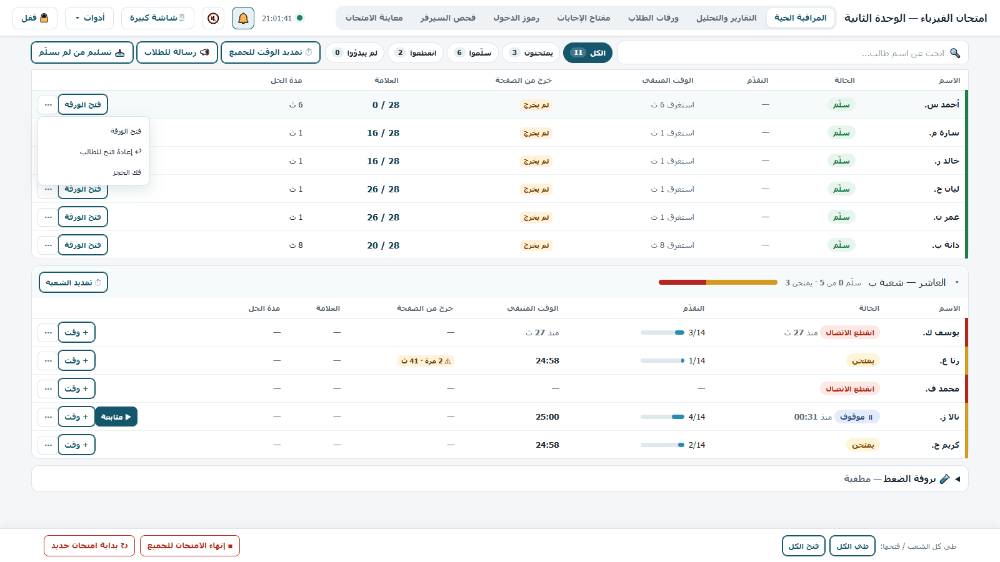<figcaption>قائمة طالب «سلّم»: إعادة فتح للطالب، وفك الحجز.</figcaption></figure>

### الأوامر الجماعية

<figure class="fig half">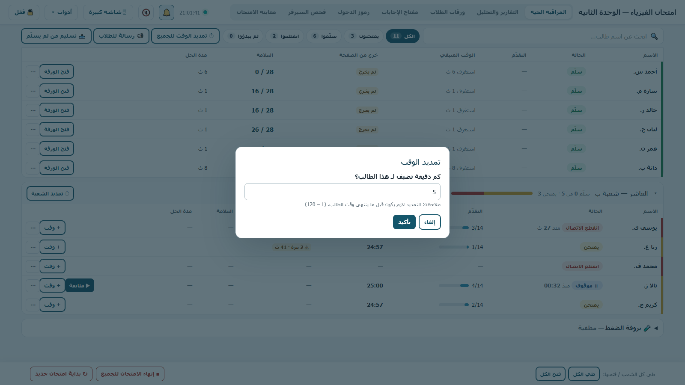<figcaption>تمديد الوقت: اكتب عدد الدقائق</figcaption></figure>

<figure class="fig half">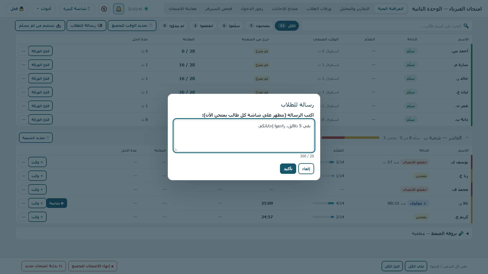<figcaption>رسالة بتظهر على شاشة كل طالب</figcaption></figure>

- **⏱ تمديد الوقت للجميع** (أو «تمديد الشعبة» أو «+ وقت» لطالب): قبل انتهاء وقت الطالب.
- **📣 رسالة للطلاب:** (مثلاً «بقي 5 دقائق») بتظهر على شاشة كل طالب يمتحن خلال ثواني.
- **■ إنهاء الامتحان للجميع** و**📥 تسليم من لم يسلّم** (انظر الخطوة 10).

### شاشة كبيرة (للبروجكتر)

زر **🖥 شاشة كبيرة** بيعرض مربعات كبيرة بلون كل طالب وحالته، مناسبة للشاشة اللي قدام الصف (بدون أي أوامر). الرجوع: «← رجوع للوضع العادي».

<figure class="fig">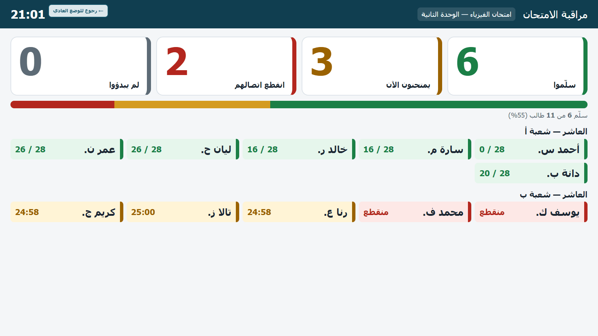<figcaption>العرض الكبير: العدّادات الأربعة ومربع لكل طالب.</figcaption></figure>

### المفتاح، الورقات، الرموز، التقرير والفحص

<figure class="fig">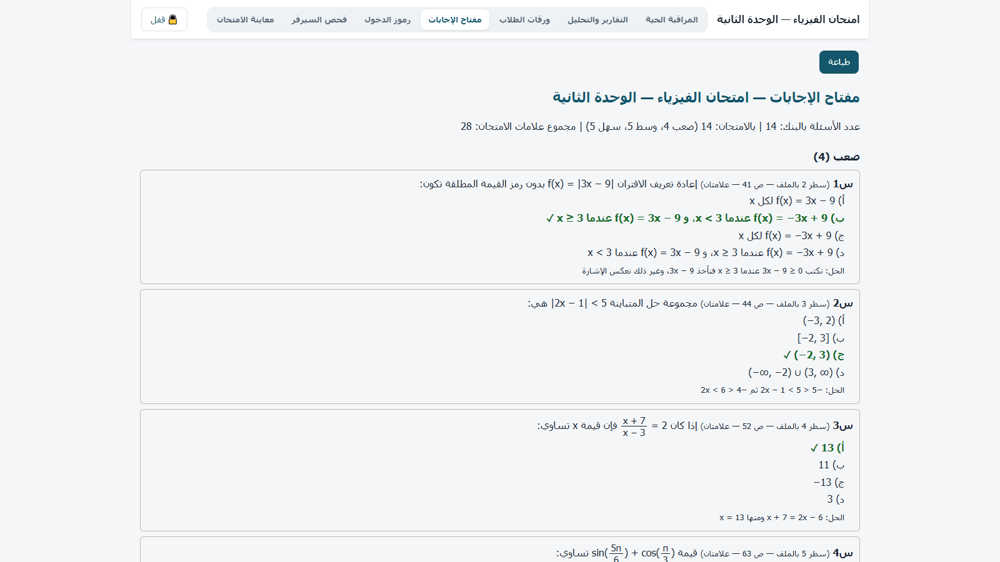<figcaption>صفحة المفتاح: كل سؤال مع الجواب الصحيح (✓) والحل. راجعها قبل الامتحان.</figcaption></figure>

<figure class="fig">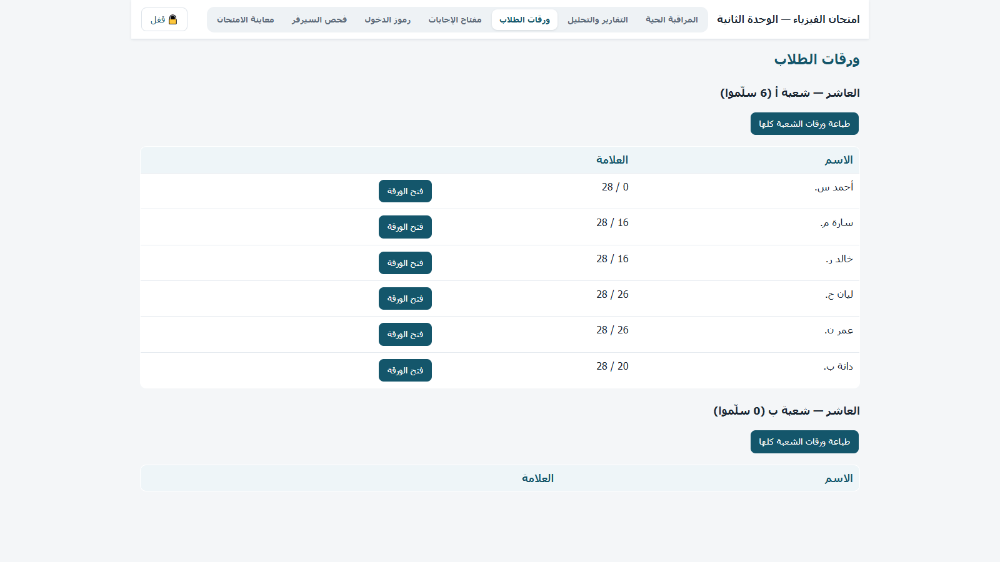<figcaption>ورقات الطلاب: علامة كل طالب وفتح ورقته (أسئلته وإجاباته) للطباعة.</figcaption></figure>

<figure class="fig">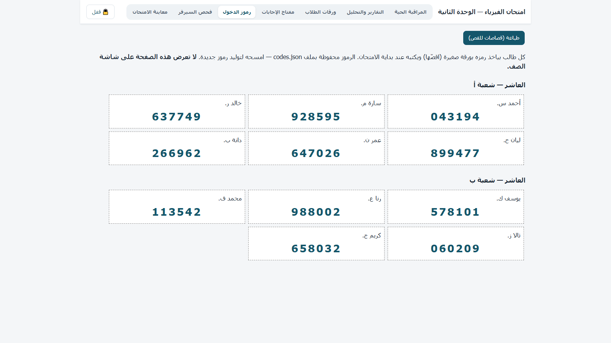<figcaption>رموز الدخول (إذا فعّلتها): اطبعها وقصّ كل رمز وسلّمه لصاحبه.</figcaption></figure>

<figure class="fig">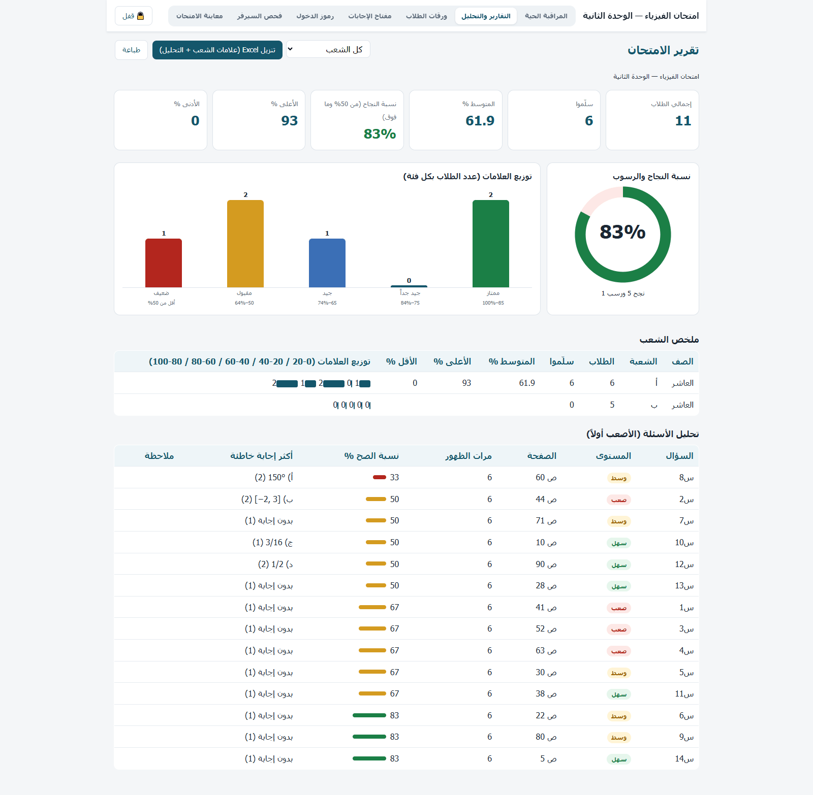<figcaption>التقرير: المتوسط ونسبة النجاح وتوزيع العلامات (بقائمة لاختيار الشعبة) وتحليل كل سؤال: أيها الأصعب وأكتر إجابة خاطئة.</figcaption></figure>

<figure class="fig">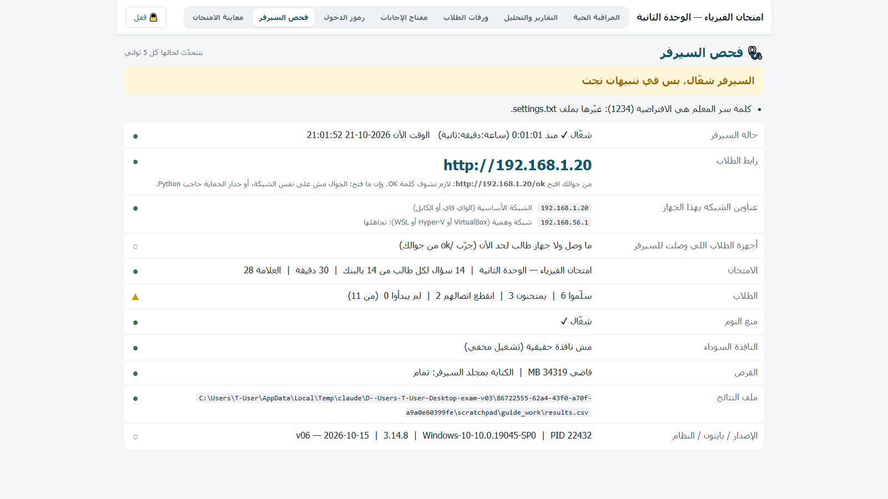<figcaption>فحص السيرفر: الأخضر ✓ سليم، والتنبيه الأصفر مثل «غيّر كلمة السر الافتراضية».</figcaption></figure>

<figure class="fig">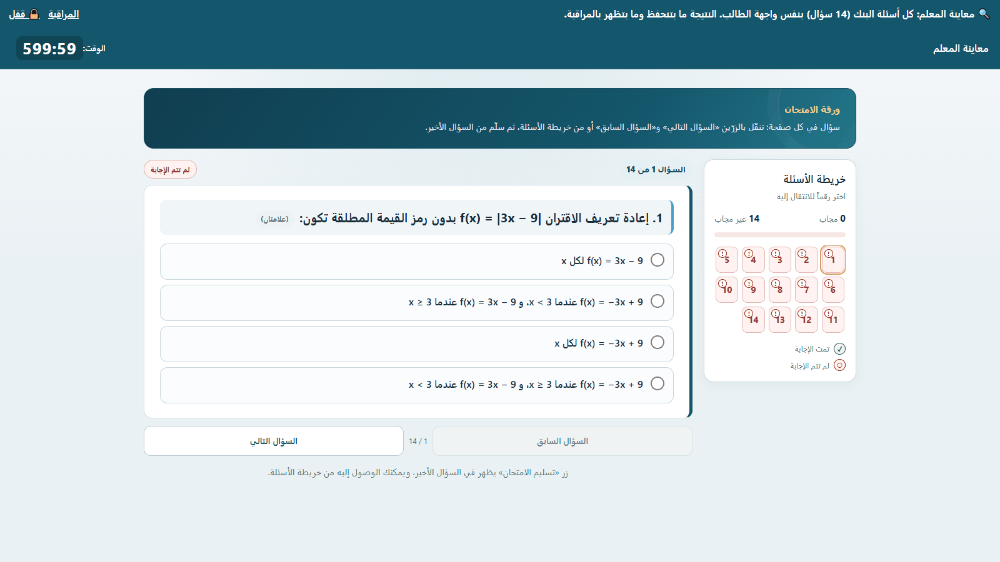<figcaption>معاينة الامتحان: بتحلّه كأنك طالب لتجربته (ما بتنحفظ النتيجة).</figcaption></figure>

---

## الخطوة 9: الطوارئ: شو أعمل إذا صار كذا؟

**أهم قاعدة: لا تتوتر.** كل شي محفوظ على جهاز الأستاذ (الأوراق والإجابات والتسليمات). صفحات الطلاب بتحتفظ بإجاباتها وبتحاول تتصل لحالها.

| الحالة | شو تعمل |
|---|---|
| **النافذة السوداء سكّرت، أو السيرفر وقف، أو الجهاز انطفأ** | 1) قل للطلاب فوراً: «**لا تسكّروا الصفحة ولا تعملوا Refresh، وكمّلوا حلّكم**». 2) شغّل **`start.bat`** من **نفس المجلد**. 3) تأكد إن الرابط ما تغيّر (`exam_info.txt` أو `/health`). 4) راقب المراقبة: المنقطعين بيرجعوا لحالهم، والوقت **بيتعوّض تلقائياً** (شريط أزرق). إذا طال التوقف أكثر من 30 دقيقة (شريط أصفر): «⏱ تمديد الوقت للجميع» |
| **جهاز السيرفر «نام» (قفلت الغطاء)** | افتحه وفك القفل **فقط**. السيرفر بيكمل ويعوّض الوقت. لا تشغّل شي |
| **الواي فاي وقع** | لا تعمل شي. الطلاب بيرجعوا لحالهم |
| **جهاز طالب تعطّل / بطارية الجوال خلصت** | **نقل لجهاز آخر** (انظر تحت) |
| **طالب سكّر الصفحة أو انقطع اتصاله** | غالباً بيرجع لحاله بعد دقيقة. إذا ما رجع: يفتح الرابط من جديد ويختار اسمه وبيكمل بإجاباته |
| **ظهر للطالب «هذا الاسم بدأ الامتحان من جهاز آخر»** | بدأ من جهاز ثاني قبل: **نقل لجهاز آخر** |
| **طالب بدّه يطلع (حمّام)** | ⋯ جنب اسمه ← **⏸ إيقاف مؤقت**. لما يرجع: **▶ متابعة** (وقته بيكمل من محل ما وقف) |
| **طالب سلّم بالغلط** | ⋯ جنب اسمه ← **↩ إعادة فتح للطالب** (بيرجع بإجاباته ووقته الباقي، دقيقتين على الأقل) |
| **الطلاب بدهم وقت إضافي** | **⏱ تمديد الوقت للجميع** (أو لشعبة أو لطالب). **قبل** ما ينتهي الوقت |
| **بدك تبلّغ الكل بشي** | **📣 رسالة للطلاب** |
| **طالب ما رجع وانتهى الوقت** | ⋯ ← **تسليم عنه** (بيصحّح إجاباته المحفوظة) |
| **الطلاب ما بيفتحوا الرابط** | هل الجوال على **نفس الواي فاي**؟ هل ضغطت **Allow access** (الخطوة 6)؟ جرّب `الرابط/ok` من جوالك، وافتح `http://localhost/health`. بعض الشبكات بتعزل الأجهزة: استعمل هوتسبوت من جوالك (رابطه بـ `/link`) |
| **طالب بيقول «تم التسليم مسبقاً» وهو ما سلّم** | ما ضغطت «بداية امتحان جديد» بعد الامتحان اللي قبله، أو عنوان الامتحان مكرر (اتركه فاضي بـ settings) |
| **اكتشفت خطأ بسؤال أثناء الامتحان** | **لا تعدّل ملف الأسئلة أثناء الامتحان.** سجّل رقم السؤال، وبعد الامتحان عالج أثره يدوياً (مثلاً عدّل العلامات بملف Excel) وصحّح الملف عند Claude للمرة الجاية |
| **الجهاز تعطّل نهائياً** | انسخ **مجلد الامتحان كاملاً** لجهاز ثاني على نفس الشبكة (بدون ما تثبّت شي) وشغّل `start.bat` هناك. الرابط بيتغير، فكل طالب بيفتح الرابط الجديد وإنت تعمل له «نقل لجهاز آخر» ليكمل بنفس ورقته. للامتحانات المهمة جهّز جهازاً احتياطياً |
| **مشكلة ما فهمت سببها** | دبل كليك على **`report_problem.bat`**، اكتب بأول الملف اللي بيفتح شو حصل، وارسله لـ Claude |

### طريقة «نقل لجهاز آخر» (خطوة بخطوة)

<figure class="fig">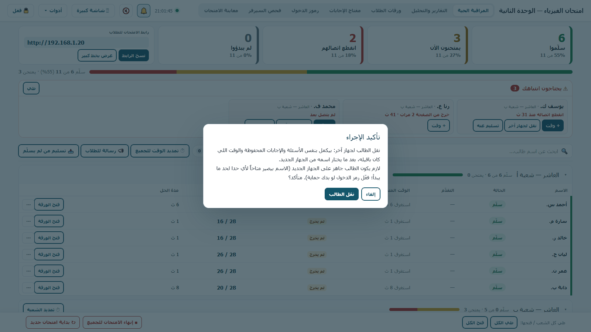<figcaption>نافذة تأكيد «نقل لجهاز آخر».</figcaption></figure>

1. اطلب من الطالب يروح لجهاز ثاني ويفتح **نفس الرابط** وهو **واقف عند الجهاز الجديد**.
2. من المراقبة: ⋯ جنب اسمه ← **نقل لجهاز آخر** ← **نقل الطالب**.
3. الطالب يختار **اسمه** ويضغط «ابدأ». بيكمل **بنفس الأسئلة والإجابات والوقت اللي كان باقيله**.

### ممنوع وقت الطوارئ

- **«فك الحجز»** (بيمسح إجابات الطالب): استعمل «نقل لجهاز آخر» بدلاً منه.
- **«بداية امتحان جديد»**، وتعديل ملف الأسئلة أو `settings.txt` أثناء الامتحان.
- الضغط داخل النافذة السوداء، أو تشغيل `start.bat` مرتين من نفس المجلد.

---

## الخطوة 10: نهاية الامتحان: شو تسحب وشو تسكّر

**اتبع هالترتيب:**

1. **تأكد من المراقبة** إن كل الطلاب «سلّموا» (عدّاد «لم يبدؤوا» و«يمتحنون» و«انقطعوا» صفر).
2. إذا باقي أحد: **■ إنهاء الامتحان للجميع** (بيتسلّم الطلاب تلقائياً خلال ثواني، وما بيقدر حدا يبدأ بعدها). **انتظر دقيقة**، ثم **📥 تسليم من لم يسلّم** لمن ظل (منقطع مثلاً).

<figure class="fig half">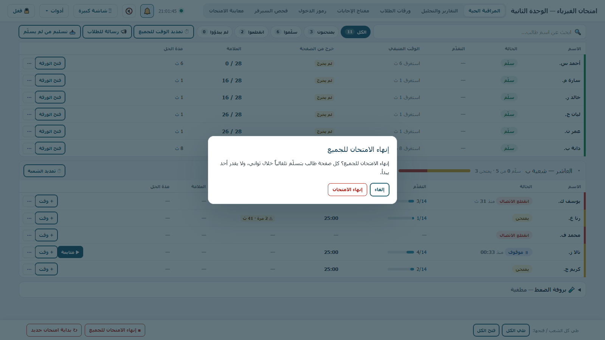<figcaption>تأكيد «إنهاء الامتحان للجميع»</figcaption></figure>

<figure class="fig half">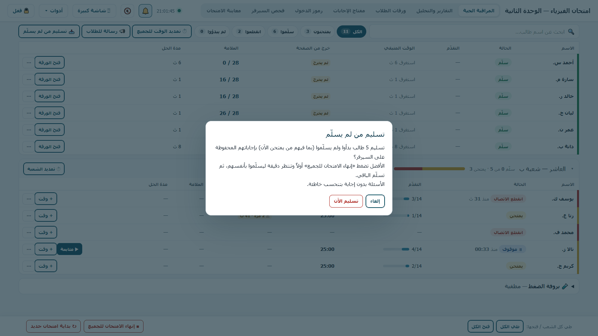<figcaption>تأكيد «تسليم من لم يسلّم»</figcaption></figure>

3. **اسحب النتائج (قبل ما تسكّر أي شي):**
   - **ملف Excel:** من `http://localhost/report` اضغط **تنزيل Excel** (أو افتح `http://localhost/report.xlsx`): علامات كل شعبة + تحليل الأسئلة.
   - **الورقات للطباعة:** من `http://localhost/sheet` (ورقة كل طالب: أسئلته وإجاباته وعلامته).
   - **التقرير** `http://localhost/report`: للعرض أو الطباعة (زر «طباعة»).
   - النتائج محفوظة كمان بملف `results.csv` بمجلد الامتحان.
4. **اعمل نسخة احتياطية:** انسخ **مجلد الامتحان كاملاً** لمكان ثاني (فلاشة أو جهاز آخر).
5. **«↻ بداية امتحان جديد»** (الزر الأحمر): بيحفظ نتائج الامتحان بمجلد **`archive_...`** وبيصفّر الشاشة لامتحان جديد. جواه مجلد **`نتائج`** جاهز تعطيه لأي أستاذ: دبل كليك على `ابدأ_من_هنا.html` بيفتح بأي متصفح **بدون أي برنامج**. بتطلب تأكيدين، **ولا تضغطه قبل ما تسحب Excel وتطبع** اللي بدك.
6. **سكّر النافذة السوداء** (أو Ctrl+C).

<div class="ok"><b>وإذا ما كان في امتحان بعده:</b> اضغط «🔒 قفل» بأعلى الصفحة، وسكّر المتصفح والنافذة السوداء.</div>

**إذا بدك تجهّز امتحان جديد بعدين:** ابدأ من الخطوة 1، وتذكّر «بداية امتحان جديد» **قبل** ما تحط ملف الأسئلة الجديد. وإذا نسيتها بيطلع تنبيه أحمر بالمراقبة.

---

## قبل أول امتحان حقيقي: بروفة

لا تجرّب النظام لأول مرة يوم الامتحان. اعمل بروفة:

1. شغّل `start.bat` (وسمح لـ Python بجدار الحماية)، وافتح `http://localhost/health`: **لازم تكون خضراء**.
2. افتح الرابط من **3 إلى 5 جوالات** (آيفون وأندرويد)، وحلّ وسلّم، وشوف شاشة المراقبة.
3. جرّب الطوارئ: سكّر النافذة السوداء عمداً، وشغّل `start.bat` وشوف كيف يرجع الطلاب.
4. اضغط «بداية امتحان جديد» لتصفير التجربة.
5. **بروفة الضغط (اختيارية قبل امتحان كبير):** من المراقبة ← **أدوات ▾ ← 🧪 بروفة الضغط**: كل أجهزة المختبر بتضغط «ابدأ» بنفس اللحظة وبتشوف كم جهاز نجح. التفاصيل بـ `00_دليل_المشرف.pdf`.

## قائمة سريعة يوم الامتحان

- ☐ `/health` أخضر، وجوالك فتح `الرابط/ok` وشفت OK.
- ☐ كلمة سر المعلم مش `1234`.
- ☐ راجعت **مفتاح الإجابات** (`/key`) وسؤالك الصعب.
- ☐ النافذة السوداء شغّالة ومصغّرة، والجهاز موصول بالكهرباء.
- ☐ الرابط مكتوب على السبورة أو معروض.
- ☐ ورقة الطوارئ `04_ورقة_الطوارئ.pdf` مطبوعة جنب الجهاز.

## امتحانان بنفس الوقت؟

كل امتحان بـ **مجلد منفصل** (فُكّ الزيب مرة لكل امتحان، **ولا تنسخ مجلداً سبق وشغّلت منه امتحاناً** لأن نسخته بتحمل نتائجه). شغّل `start.bat` من كل مجلد: الأول بياخذ رابطاً عادياً، والثاني بيضيف رقماً (`:8000`). **اعطِ كل امتحان رابط نافذته هو.** التفاصيل بـ `00_دليل_المشرف.pdf`.

## ملفات بتنعمل لحالها (لا تحتاجها غالباً)

| الملف | فيه |
|---|---|
| `exam_info.txt` | الرابط وصفحات الأستاذ بالعربي |
| `check_report.txt` | تقرير الفحص |
| `exam_error.txt` | سبب الخطأ إذا رفض النظام التشغيل |
| `exam_log.txt` | سجل الأحداث (من بدأ، من سلّم، تنبيهات) |
| `results.csv` | النتائج |
| `archive_...` | أرشيف كل امتحان بعد «بداية امتحان جديد» (فيه مجلد «نتائج» للأستاذ) |

---

*لأي مشكلة بالدليل أو بالنظام: `report_problem.bat` ثم ارسل الملف لـ Claude. وللتفاصيل الكاملة: `00_دليل_المشرف.pdf`.*
